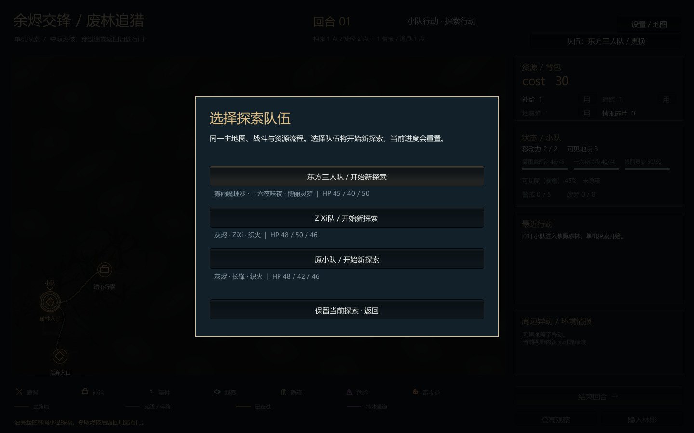

# touhou · Unity 主 Demo 人物整合

东方三人组（魔理沙、咲夜、灵梦）和ZiXi已进入同一个森林主Demo。地图顶部“队伍 / 更换”可选择东方队、ZiXi队和原小队；不再需要打开另一个角色开发版。七名角色保留已有技能与状态，八组3,474项检查、三套队伍实际战斗胜利及战后生命/钱包继承通过。

- [下载Windows成品](https://github.com/zixinyc/clash-roguelike/raw/refs/heads/touhou/releases/ClashRoguelike-Unity-Windows-touhou.zip)：解压运行EXE，无需安装Unity。
- [Unity运行与构建](unity-client/README.md)
- [角色、主流程、修改清单与限制](unity-client/MAIN_DEMO.md)
- [当前项目清单](unity-client/PROJECT_INVENTORY.md)

当前Unity为三套预设队伍；自由混编、多人、存档与正式立绘未完成。当前攻击累计规则继承本地正式版。本机未完成Editor全量构建；成品是已实测的Windows Mono播放器更新。下方Godot参考同步main的阵容/卡组与少人出战成果，未宣称两引擎完全一致。

---

# Clash Roguelike｜拼点肉鸽

探索《边狱巴士》式拼点战斗与《杀戮尖塔》式卡牌构筑、随机路线和战后成长的结合，由朋友共同协作开发。

**当前阶段（2026-11-17）：Godot 战斗与废林探索原型。** 现在可以先配置阵容和卡组，再用任意角色单走或混编出战。

## 下载与运行

1. 通过 **Code → Download ZIP** 下载 `main` 源码并解压，或克隆仓库。
2. 使用 [Godot 4.7.2 标准版](https://github.com/godotengine/godot-builds/releases/tag/4.7.2-stable) 导入 `battle-demo/project.godot`，按 **F5** 打开「阵容与卡组」。
3. 选择 1～3 名角色、携带卡牌和敌组，然后开始战斗。想测试单走，点「清空配队」后只选一人。

Windows 也可运行 [启动余烬交锋.cmd](battle-demo/启动余烬交锋.cmd)，按 `1` 打开战斗配置，按 `2` 进入废林探索。源码需配合 Godot 运行。公开版本可用程序绘制的默认画面。

## 试玩进度

- **阵容与卡组**：灰烬、长锋、织火、咲夜、灵梦和 ZiXi 共六名角色。可勾选通用牌和出战成员的专属牌，所选手牌每回合恢复。
- **少人平衡**：单人行动格按回合从 3 → 6 → 9，双人从 6 → 9，三人开局 9 格。每组三格最多安排两次行动。
- **战斗**：支持速度接招、硬币拼点、准备与强化、目标可用性提示、打击停顿和两组敌人。可手动安排，也可用「自动安排」快速试玩。
- **探索**：废林小样包含迷雾、普通战斗、精英、营地、商店和事件，生命与 cost 在同次探索中跨战斗保留。

发布前验证配置与少人补格、角色专项、716 项战斗规则断言、地图及图形模式自动流程。下一阶段通过实际对局检验单人开局和混编阵容强度，再扩充地图与构筑内容。[运行与测试详情](battle-demo/README.md)。

## 想做出的体验

- 对抗：双方技能比拼威力，硬币破坏会改变后续交锋。
- 演出：前冲、对撞、破币与追击，让每次胜负有清晰的画面和声音反馈。
- 构筑：通过技能、卡牌和成长奖励，形成不同的应对方式。
- 冒险：在分岔路线、战斗和事件之间选择，完成一局可反复挑战的旅程。

已确定采用小队、手牌与拼点，出牌与购物共用可跨战斗保留的 cost 钱包；战斗具有基础与表现收入、出牌限制和失败部分退款。具体数值、角色数量、操作方式与美术风格仍在讨论。

## 从这里开始

| 你想了解什么 | 文档 |
| --- | --- |
| 下载、运行或修改当前战斗原型 | [Godot 战斗演示](battle-demo/README.md) |
| 当前确定了哪些玩法，哪些数值还在测试 | [玩法设计草案 v0.1](docs/玩法设计/玩法设计草案.md) |
| 如何和朋友一起使用仓库 | [GitHub 公有仓库协作指南](docs/协作指南/GitHub协作指南.md) |
| 有哪些可参考的项目，拼点如何实现 | [技术调研](docs/技术调研/拼点肉鸽技术调研.md) |
| 接下来分几步开发 | [开发路线](docs/玩法设计/开发路线.md) |
| 想和朋友讨论技能或 hunter | [文档讨论](docs/文档讨论/README.md) |
| 所有文档与当前状态 | [按分类查看文档](docs/README.md) |

## 技术方向

已选择 Godot 4 与 GDScript。当前原型将战斗结算与动画播放分开，使用确定的随机种子与事件记录；加速演出不改变规则结果。

## 一起协作

1. 在 [Issues](https://github.com/zixinyc/clash-roguelike/issues) 记录想法、任务或问题，一件事写一个 Issue。
2. 动手前写明认领人、改动范围和完成标准，避免两个人重复修改同一处。
3. 从最新的 `main` 创建任务分支，例如 `docs/combat-ideas`。
4. 完成后发起 Pull Request（PR，合并申请），让另一位成员检查改动后合并。

这些是团队建议，尚未通过分支保护强制执行。具体网页操作见[协作指南](docs/协作指南/GitHub协作指南.md)。

## 素材与许可

参考作品用于说明玩法灵感，本项目与其开发商无关联。新增角色、美术、音乐和动画应使用原创或获得许可的素材，并记录来源。

本仓库原创代码、程序绘制内容与文档采用 [MIT 许可证](LICENSE)，允许使用、修改、再分发及商业使用，分发时保留版权声明和许可文本。Godot 引擎与其他第三方内容遵守各自许可证。