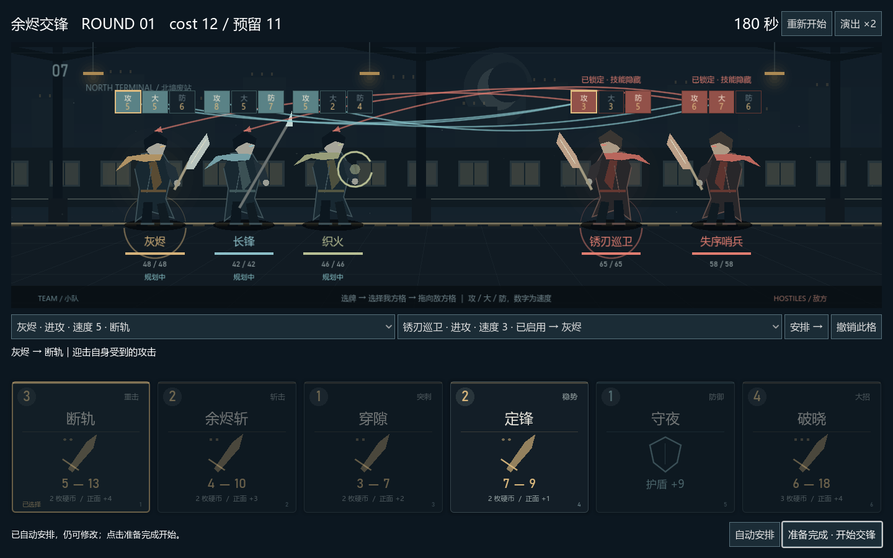

# Clash Roguelike｜拼点肉鸽

探索《边狱巴士》式拼点战斗与《杀戮尖塔》式卡牌构筑、随机路线和战后成长的结合，由朋友共同协作开发。

**当前阶段：Godot 单场战斗原型。已提供可下载、可修改的源工程，支持敌方先规划、隐藏技能与公开箭头、角色随机速度、多行动格、180 秒响应、拼点与 cost。**
## 这是总文档
## 下载与运行

1. 点击 **Code → Download ZIP** 下载 main 分支源码并解压，或使用 Git 克隆仓库。
2. 下载 [Godot 4.7.2 标准版](https://github.com/godotengine/godot-builds/releases/tag/4.7.2-stable)，不需要 .NET 版。
3. 在 Godot 中导入 **battle-demo/project.godot**，按 **F5** 运行。
4. 点击游戏右下角的 **自动安排**，再点击 **准备完成**，或自己拖动行动箭头安排出牌。

[完整运行与修改说明](battle-demo/README.md)。源码 ZIP 不包含引擎和独立游戏安装包。

## 想做出的体验

- 对抗：双方技能比拼威力，硬币破坏会改变后续交锋。
- 演出：前冲、对撞、破币与追击，让每次胜负有清晰的画面和声音反馈。
- 构筑：通过技能、卡牌和成长奖励，形成不同的应对方式。
- 冒险：在分岔路线、战斗和事件之间选择，完成一局可反复挑战的旅程。

已确定采用小队、手牌与拼点，出牌与购物共用可跨战斗保留的 cost 钱包；战斗具有基础与表现收入、出牌限制和失败部分退款。具体数值、角色数量、操作方式与美术风格仍在讨论。

## 从这里开始

| 你想了解什么 | 文档 |
| --- | --- |
| 下载、运行或修改当前战斗原型 | [Godot 战斗演示](battle-demo/README.md) |
| 当前确定了哪些玩法，哪些数值还在测试 | [玩法设计草案 v0.1](docs/玩法设计/玩法设计草案.md) |
| 如何和朋友一起使用仓库 | [GitHub 公有仓库协作指南](docs/协作指南/GitHub协作指南.md) |
| 有哪些可参考的项目，拼点如何实现 | [技术调研](docs/技术调研/拼点肉鸽技术调研.md) |
| 接下来分几步开发 | [开发路线](docs/玩法设计/开发路线.md) |
| 想和朋友讨论技能或 hunter | [文档讨论](docs/文档讨论/README.md) |
| 所有文档与当前状态 | [按分类查看文档](docs/README.md) |

## 技术方向

已选择 Godot 4 与 GDScript。当前原型将战斗结算与动画播放分开，使用确定的随机种子与事件记录；加速演出不改变规则结果。

当前优先通过单场战斗试玩验证拼点规则和手感，再讨论后续地图、成长与联机。

## 一起协作

1. 在 [Issues](https://github.com/zixinyc/clash-roguelike/issues) 记录想法、任务或问题，一件事写一个 Issue。
2. 动手前写明认领人、改动范围和完成标准，避免两个人重复修改同一处。
3. 从最新的 `main` 创建任务分支，例如 `docs/combat-ideas`。
4. 完成后发起 Pull Request（PR，合并申请），让另一位成员检查改动后合并。

这些是团队建议，尚未通过分支保护强制执行。具体网页操作见[协作指南](docs/协作指南/GitHub协作指南.md)。

## 素材与许可

参考作品用于说明玩法灵感，本项目与其开发商无关联。新增角色、美术、音乐和动画应使用原创或获得许可的素材，并记录来源。

本仓库原创代码、程序绘制内容与文档采用 [MIT 许可证](LICENSE)，允许使用、修改、再分发及商业使用，分发时保留版权声明和许可文本。Godot 引擎与其他第三方内容遵守各自许可证。
