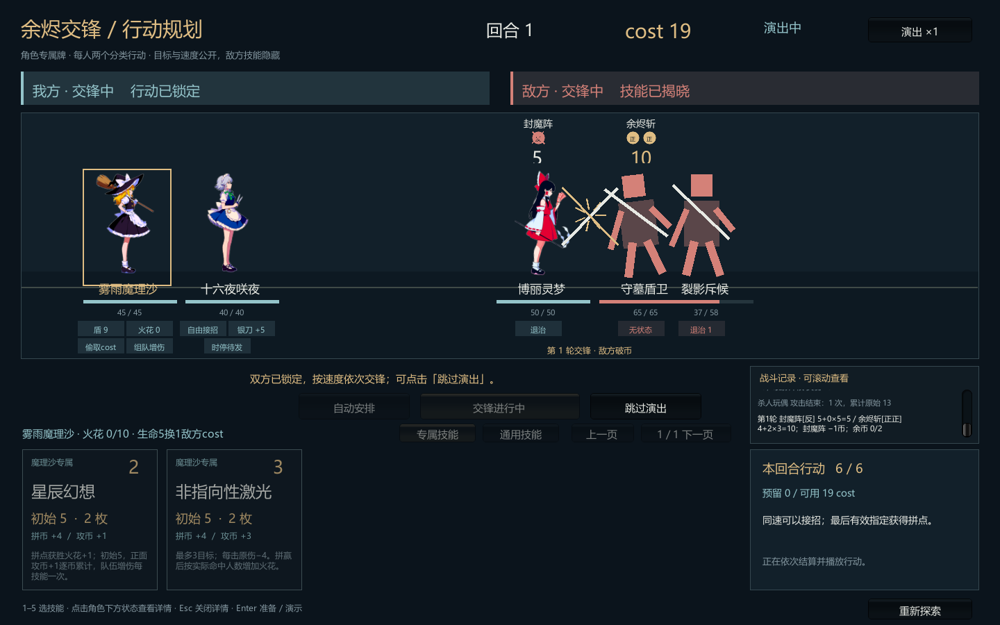

# touhou · 随机关卡与战斗UI雏形

已接入随机森林、战前A/B角色技能组、彩色拼点连线与风险、原战场立绘直接交锋和硬币跟随；不再创建独立交锋框。保留东方三人、ZiXi和原小队，兼容现有透明立绘与当前战斗数值。

- [下载Windows成品](https://github.com/zixinyc/clash-roguelike/raw/refs/heads/touhou/releases/ClashRoguelike-Unity-Windows-touhou.zip)：解压运行EXE，无需安装Unity。
- [本轮设计、修改清单与限制](unity-client/PROTOTYPE.md)
- [Unity运行与构建](unity-client/README.md)
- [验证记录](unity-client/VALIDATION.md)：九组5,282项与实际战斗完整结算/地图返回通过。

风险为基础牌面预估，不泄露隐藏敌方具体技能；A/B方案暂存当前会话。立绘位移/刀光是雏形，完整动画、存档、联机未完成；Editor全量构建受许可限制，本次为已实测的Windows Mono播放器更新。

Godot参考工程保留此前main同步成果；本轮UI雏形实现在Unity，未宣称两个引擎功能完全一致。Godot入口与原设计见battle-demo和docs目录。
