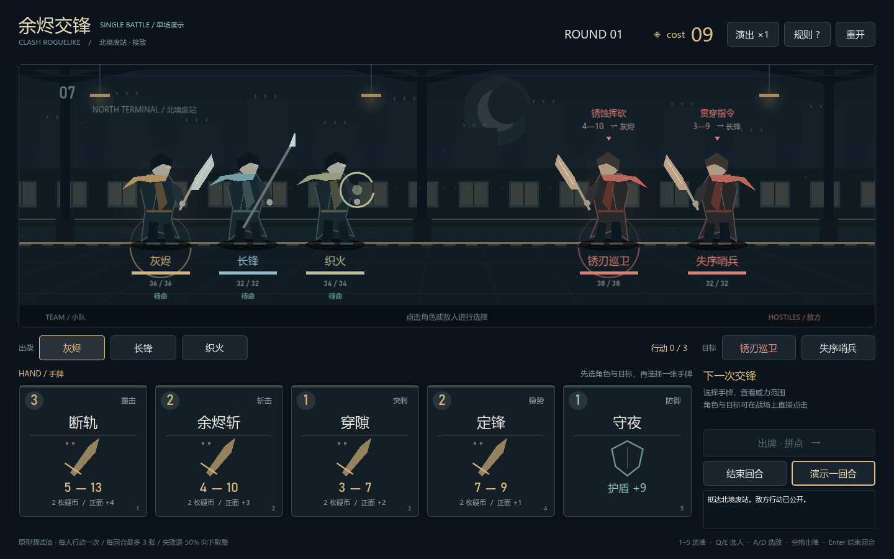

# 余烬交锋 · Godot 单场战斗演示

可下载、运行和修改的 Godot 源工程，用来体验小队、手牌、拼点和 cost 收支。场景、角色与卡牌图案均由程序绘制，音效由程序合成。



[查看拼点瞬间](preview/clash.png) · [查看胜利结算](preview/victory.png)

## 运行

1. 在[仓库首页](https://github.com/zixinyc/clash-roguelike)点击 **Code → Download ZIP**，解压到可写目录。也可以用 Git 克隆 main 分支。
2. 下载并解压 [Godot 4.7.2 标准版](https://github.com/godotengine/godot-builds/releases/tag/4.7.2-stable)。Windows 选择 Godot_v4.7.2-stable_win64.exe.zip；本项目不需要 .NET 版。
3. 打开 Godot 项目管理器，点击 **Import / 导入**，选择本目录的 **project.godot**，进入编辑器后按 **F5**。
4. 想快速看流程，点击游戏右下角的 **演示一回合**。

源码 ZIP 不包含引擎，也不是独立游戏安装包。当前项目使用 GDScript 与 Compatibility 渲染，已验证 Windows；其他桌面系统可尝试用对应的 Godot 标准版导入，但尚未验收。

Windows 启动脚本还支持三种引擎位置：将 Godot 可执行文件路径作为第一个参数、通过 GODOT_BIN 指定、或在 PATH 中找到 godot.exe / godot4.exe。开发者本机 .tools 中的便携版也可直接调用。例如：

```text
启动战斗演示.cmd "C:\你的工具目录\Godot_v4.7.2-stable_win64.exe"
```

这里的路径是填写示例，不是仓库作者的本机配置。也可以将已解压的 Godot 可执行文件拖到启动脚本上。

## 怎么玩

1. 默认已选中我方“灰烬”和敌方“锈刃巡卫”；点击战场或下方按钮可以换人、换目标。
2. 点击一张牌，右侧查看威力范围和费用，再点击“出牌 · 拼点”。
3. 双方比较威力、失败方破币，剩余硬币归零后由胜方攻击。
4. 本回合最多使用三位成员各一次。点击“结束回合”执行敌方剩余行动、获得 3 cost 并重新抽牌。
5. 点击“演示一回合”可观看自动出牌；点击顶部“演出 ×1”可切换 ×2、×4；“重开”以相同随机种子重新开始。

快捷键：1～5 选牌，Q/E 切换我方成员，A/D 切换敌人，空格出牌，Enter 结束回合，R 重开。鼠标与键盘焦点均可用于操作。

## 测试配置

- 三人共用手牌和钱包，初始 9 cost；每回合三张，每位成员行动一次。
- 基础牌费用 1～3，失败退还实付费用的 50%，向下取整，退款不恢复行动。
- 每回合首次拼点胜利 +1 cost；新回合 +3 cost。
- 我方硬币正面率 65%，敌方 50%；连续三次平局后随机决胜一次，避免僵持。
- “守夜”获得本回合护盾。敌人技能在一次拼点后消耗，后续攻击该敌人属于单方面攻击。
- 打出后从手牌移除；新回合重新抽五张。本原型尚未实现正式抽牌堆、弃牌堆、卡牌升级或跨战斗流程。

以上均为演示规则与数值，尚未做正式平衡。地图、猎人、联机和复活模式仍保留在设计文档中，不属于本场原型。

## 代码入口

- scripts/battle_rules.gd：纯战斗状态与事件结算，不依赖动画。
- scripts/main.gd：界面、选择、事件播放与回合流程。
- scripts/battle_stage.gd：战场、角色与拼点演出。
- scripts/card_view.gd：卡牌绘制与选择反馈。
- scripts/synth_audio.gd：合成音效，使用独立随机源。
- tests/test_rules.gd：费用、退款、确定性、护盾和胜败检查。

## 验证命令

在本目录调用 Godot 可执行文件，以下命令中的 godot 代表你使用的 Godot 路径：

```text
godot --headless --path . --editor --import --quit
godot --headless --path . --script tests/test_rules.gd
godot --path . -- --visual-smoke
```

最后一条命令会在 test-output 生成实际视口截图并完成一轮自动战斗验收。该目录与引擎缓存不应提交到仓库。

## 实际验收（2026-10-29）

- 引擎：Godot 4.7.2 官方 Windows 便携版，下载文件通过发布方 SHA-512 校验。
- 项目导入、脚本加载通过；215 项规则断言通过。
- 实际渲染验证：1440×900、1000×650；中文、卡牌、状态和结算弹层均已查看。
- 通过真实输入事件检查选人、选敌、选牌及空格出牌，完整运行至第 2 回合胜利；失败弹层与两种结果后的重开均通过。
- 当前机器 WASAPI 输出设备初始化失败，引擎回退到静音驱动；合成音效未完成实听验收。可用 --audio-driver Dummy 进行静音测试。
- 未验证：其他电脑、手柄完整操作及 Godot 其他版本。当前没有网络对战和正式发行包。

启动脚本仅为 Godot 子进程设置本项目内的 APPDATA 路径，不修改系统环境变量。

## 修改和分享

本仓库原创代码、程序绘制内容与文档采用 [MIT 许可证](../LICENSE)：允许使用、修改、再分发及商业使用，分发时保留版权声明与许可文本。Godot 引擎及未来引入的第三方素材各自遵守其许可证。

修改规则可先查看 scripts/battle_rules.gd；修改画面查看 scripts/battle_stage.gd；修改交互与布局查看 scripts/main.gd。完成后用上面的测试命令检查，向 main 提交 PR。不要把引擎、.godot 缓存和 test-output 提交到仓库。
