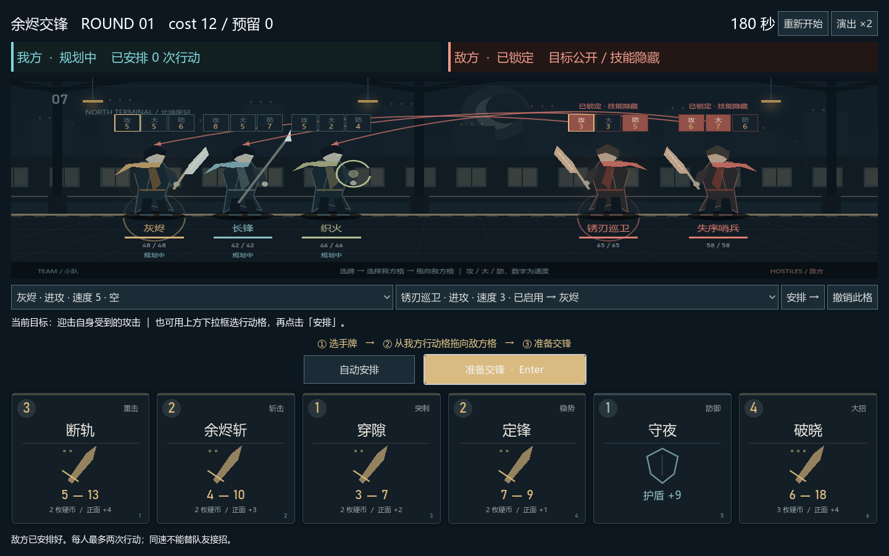

# 余烬交锋 · Godot 单场战斗演示

可下载、运行和修改的 Godot 源工程，用来体验小队、手牌、拼点和 cost 收支。雨夜废站、角色立绘和废林地形使用生成素材，战斗交互与演出由 Godot 绘制，音效由程序合成。



当前版本：敌方先规划、公开目标箭头、隐藏技能、180 秒响应、多行动格与速度接招。

## 运行

Windows 可以双击 [启动余烬交锋.cmd](启动余烬交锋.cmd)，按 `1` 进入战斗演示，按 `2` 进入废林探索。

1. 在[仓库首页](https://github.com/zixinyc/clash-roguelike)点击 **Code → Download ZIP**，解压到可写目录。也可以用 Git 克隆 main 分支。
2. 下载并解压 [Godot 4.7.2 标准版](https://github.com/godotengine/godot-builds/releases/tag/4.7.2-stable)。Windows 选择 Godot_v4.7.2-stable_win64.exe.zip；本项目不需要 .NET 版。
3. 打开 Godot 项目管理器，点击 **Import / 导入**，选择本目录的 **project.godot**，进入编辑器后按 **F5**。
4. 想快速看流程，点击游戏右下角的 **自动安排**，然后点击 **准备完成**。

源码 ZIP 不包含引擎，也不是独立游戏安装包。当前项目使用 GDScript 与 Compatibility 渲染，已验证 Windows；其他桌面系统可尝试用对应的 Godot 标准版导入，但尚未验收。

Windows 启动脚本还支持三种引擎位置：将 Godot 可执行文件路径作为第一个参数、通过 GODOT_BIN 指定、或在 PATH 中找到 godot.exe / godot4.exe。开发者本机 .tools 中的便携版也可直接调用。例如：

```text
启动战斗演示.cmd "C:\你的工具目录\Godot_v4.7.2-stable_win64.exe"
```

这里的路径是填写示例，不是仓库作者的本机配置。也可以将已解压的 Godot 可执行文件拖到启动脚本上。

## 怎么玩

1. 敌方每回合先安排并锁定。格子标注攻/大/防与速度；亮起表示启用，红箭头表示敌方目标，不显示具体技能或胜率。
2. 点击战场角色、我方行动格或手牌区的角色按钮，查看该角色的专属牌；点击「通用」查看全队共用的牌。选牌后，拖动我方行动格到敌方行动格，或使用下拉框与「安排」。防御牌选中后可直接点击「安排」。
3. 同一成员可安排两次行动。安排只预留 cost，可以撤销、换牌或改目标；同一张牌不能重复占用。
4. 原目标可以迎击；速度严格更高才能替队友接招。速度由角色范围每回合随机生成，安排和撤销不会刷新速度。
5. 180 秒内点击“准备完成”提前开始；超时保留已有安排，空格待机。双方锁定后揭晓技能并按速度结算。
6. “自动安排”帮助填格，仍需点击准备完成。顶部可切换演出 ×2/×4，或重新开始。

快捷键：数字键选择当前分组中对应编号的牌，空格安排已选牌，Enter 准备交锋，Delete 撤销当前行动格。用 Tab 聚焦手牌区的按钮后，空格可切换角色、分组或选牌。

## 演示参数

三人共用十六张测试手牌、初始 30 cost；每人进攻/大招/防御三个分类格，最多启用两个。每回合 +8 cost，首次拼点获胜 +1 cost，拼点失败返还该牌费用的 50%（向下取整）。这些数值仍待平衡。

我方正面率 65%、敌方 50%。普通平局重掷，必然平局或连续 100 次平局以僵持结束、双方不伤害，退还玩家该牌一半费用。不再随机判胜。护盾在对应防御行动执行时生效。

锁定后角色/目标退场取消后续对应行动，不自动改目标、不退费。新回合恢复固定十六张测试手牌，尚无正式抽牌堆与弃牌堆。

完整规则与确认范围见[行动规划与速度](../docs/玩法设计/行动规划与速度.md)。只有本地人机演示，地图与真实联机尚未实现。

## 代码入口

完整状态流和复用入口见[原型架构与功能索引](../docs/原型架构与功能索引.md)。

- scripts/battle_rules.gd：纯战斗状态与事件结算，不依赖动画。
- scripts/main.gd：场景脚本入口。
- scripts/planning_ui.gd：规划界面、输入、计时与事件播放。
- scripts/battle_stage.gd：战场、角色与拼点演出。
- scripts/role_hand.gd：角色切换、专属与通用手牌、已安排状态。
- scripts/card_view.gd：牌面费用、威力或护盾、用途与选择反馈。
- scripts/synth_audio.gd：合成音效，使用独立随机源。
- tests/test_rules.gd / tests/test_planning.gd：费用预留、信息隐藏、确定性、速度接招与胜败检查。

## 验证命令

在本目录调用 Godot 可执行文件，以下命令中的 godot 代表你使用的 Godot 路径：

```text
godot --headless --path . --editor --import --quit
godot --headless --path . --script tests/test_rules.gd
godot --headless --path . --script tests/test_zixingyc.gd
godot --path . -- --planning-smoke
```

最后一条命令会在 test-output 生成实际视口截图并完成一轮自动战斗验收。该目录与引擎缓存不应提交到仓库。

## 实际验收（2026-10-29，行动规划版）

- Godot 4.7.2 Windows：脚本加载通过，716 项规则断言通过。
- 1440×900 与 1000×650 实际渲染，键盘选牌、鼠标拖箭头、安排、撤销、自动安排、统一结算、超时自动锁定、战斗结果与重开通过。
- 检查了公开快照不包含敌方卡牌标识；未实现网络传输，不能把此检查当作多人安全验收。
- 音效用 Dummy 驱动测试，未实听；其他平台与完整手柄操作未验收。

启动脚本仅为 Godot 子进程设置本项目内的 APPDATA 路径，不修改系统环境变量。

## 修改和分享

本仓库原创代码、程序绘制内容与文档采用 [MIT 许可证](../LICENSE)：允许使用、修改、再分发及商业使用，分发时保留版权声明与许可文本。Godot 引擎及未来引入的第三方素材各自遵守其许可证。

修改规则可先查看 scripts/battle_rules.gd；修改画面查看 scripts/battle_stage.gd；修改交互与布局查看 scripts/planning_ui.gd。完成后用上面的测试命令检查，向 main 提交 PR。不要把引擎、.godot 缓存和 test-output 提交到仓库。

## 三角色试玩（首轮参数）

三人使用现有通用手牌，每人多一项角色能力。选择行动格时可在提示栏查看能力，战斗日志会显示触发。

- 灰烬／蓄势者：拼点最终获胜时获得 1 层准备（最多 1 层）；使用「捕捉破绽」拼点时消耗准备，本次拼点威力 +4，获胜后可重新获得。
- 长锋／破阵者：使用费用至少 3 的攻击牌拼点时，基础威力 +2；最终失败则额外损失 2 生命。单方面攻击不触发。
- 织火／援护者：执行防御牌时，除自身原有护盾外，其余存活队友各获得 4 护盾，护盾持续到下回合开始。

试玩方式：手动给灰烬安排两回合拼点观察蓄势；给长锋安排断轨或破晓进行拼点观察破阵；给织火安排守夜观察队友护盾。实际结算按行动速度进行。当前已实现部分角色专属技能牌；自由加注选择尚未实现。

## 敌人组合试玩

点击顶部「切换敌组」会立即重新开始战斗，切换两组：

- 裂影斥候＋守墓盾卫：斥候速度较高，攻击实际造成伤害时可清除灰烬的准备；盾卫防御时获得 14 护盾。
- 缚咒祭司＋鸣钟行刑者：祭司防御时为另一名存活敌人提供 6 护盾；行刑者生命较高，使用重击与大招。

敌人的各回合行动格、速度、目标和结算仍遵循原有规划规则；具体牌在锁定前隐藏。数值为首轮试玩参数。游戏内仍是程序绘制的人物，概念图未拆分成可动画的立绘或模型。

## 专属技能牌与测试资源

首版试玩开局 30 cost，每回合增加 8 cost，仅用于宽松测试。手牌在原有六张通用牌之外包含角色专属牌，例如：灰烬的「观察」结束后获得准备；长锋的「破阵」是高威力攻击并触发其被动；织火的「护阵」为自己提供 9 护盾、为其他存活队友各提供 6 护盾。点击角色显示其专属牌，选牌后可在手牌区下方查看效果。

## 灰烬的准备牌组

灰烬的四张专属牌为「观察」（行动结束获得准备）、「试探」（拼点获胜获得准备）、「捕捉破绽」（拼点消耗准备，威力 +4）和「余势追击」（拼点获胜、攻击结束后对存活目标追加 4 点攻击）。准备最多一层，拼点获胜时灰烬的被动也能重新获得准备；消耗仅提升拼点，不提高攻击伤害。

## 长锋与织火的特色牌

固定手牌共 16 张，按角色展示 4、3、3 张专属牌，另有 6 张通用牌。长锋的「稳斩」是稳定的高费攻击，「裂甲强袭」是三枚硬币的高费大招，两者均触发他的高费拼点被动。织火的「守护之光」为自己提供 9 护盾、为其他存活队友各提供 8 护盾；「援火冲击」拼点获胜后，为其他存活队友各提供 4 护盾。护盾回合开始时清除，数值供测试。

## 地图探索小样

双击 `启动地图探索.cmd` 使用项目内便携 Godot 启动；也可在 Godot 编辑器中运行 `exploration_map.tscn`。点击相邻格探索并揭开迷雾，遇到敌人进入战斗；战斗结束后点击左上角“返回地图”。生命和 cost 在本次探索的战斗间保留；战败或到达出口结束探索，重新探索会重置。当前可以绕开敌人直接抵达出口。

小样使用固定地图。地形上覆盖可交互网格，金色边框标出可达格，迷雾遮住未探索地点。右侧显示小队生命和 cost。

## 地图节点试玩

地图包含普通战斗、精英、营地、商店、事件、宝藏、补给和出口。普通战斗获胜 +4 cost，精英获胜 +8 cost；营地可选治疗或领取 cost；商店以 6 cost 治疗存活队员；事件有安全和冒险两项选择；宝藏和补给提供一次性 cost。节点效果每局最多领取一次，余额不足可离开商店。治疗不会复活队员，事件损失生命不会使存活队员降至 0。重开探索重置节点及资源。

行动点属于后续备案，当前没有行动点消耗或移动限制。节点和数值均为试玩设定；地图仍为固定布局，无持久存档。

## 目标与行动格提示

进攻格偏红、大招格金色、防御格青色；空格颜色较暗。选中需要指定敌方的牌后，绿色边框表示当前可安排，灰色边框表示不能安排；鼠标停在敌方格上可查看迎击、拦截、单方面攻击或不能安排的具体原因。多人争抢同一行动时仍按现有速度规则结算。箭头线和箭头尖端已加粗。

## 阵容与卡组

启动「战斗演示」先打开独立配置页。可从七名角色中选择 1～3 名队员，选择敌组，再勾选全队通用牌与入队角色的专属牌。默认选中原阵容及其可用牌。想单走时点击「清空配队」，再只选一名角色。「开始战斗」至少需要一名角色和一张牌。

本场每回合恢复已选手牌。战斗顶部的「阵容与卡组」会结束当前测试战斗并返回配置，保留刚才的选择。单人测试使用原有的两名敌人和行动上限。

测试技能伤害时，可在「敌人组合」选择「高血量沙包」。它有 99,999 HP，不产生护盾或伤害。选亮起的进攻格可以测试拼点胜利后的效果，选空格可以测试单方面攻击。

## ZiXingYC · 未被遗忘的观测者

可选角色，在「阵容与卡组」勾选 ZiXingYC 后加入队伍，HP 40、速度 7–9。整理是符卡自带的自动结算效果：玩家只负责选牌，用哪份记忆整理成哪种语料由牌面配方决定，没有单独的整理操作。战斗顶部也有「ZiXingYC」测试阵容按钮可一键进入灰烬＋ZiXingYC＋织火。

- 注意力机制（1 cost，进攻）：拼赢额外写入一条观测；结算后按观测→关联→反思整理出推理语料。
- 残差连接（2 cost，进攻）：已整理记忆每三条让本次伤害 +2（最多 +10）；攻击后取最早三条未整理记忆，按观测→反思→关联整理出生成语料。
- 自指悖论（3 cost，进攻）：拼赢后若目标存活，使其下次与你拼点 −2，写入关联并按反思→关联→观测尝试整理检索语料。对已被削弱的目标，本次拼胜攻击额外 +3。
- 被删除的昨天（4 cost，拼点防御）：拼赢获得 10 护盾；拼败追加一条反思，已有至少三条已整理记忆时本次拼败的每段伤害先乘 0.7 再抵扣护盾。
- 记忆的终点不存在（5 cost，大招）：需要已有至少一份语料、可拼点且本场未发动两次；拼赢才发动，对每个存活敌人造成 8 + 4 × 语料总数 + min(5, 生成语料数) 点伤害，轰炸后语料保留。

记忆与语料：每次真实拼点都会留下记忆（赢＝观测，输＝反思，僵持不留），每回合最多写三条，编号整场单调递增。未整理记忆达到 5 条时自身拼点 −2，达到 8 条时 −4。整理每回合最多成功一次，材料不足时留到后续合适的牌。推理语料两份起每回合开始多 1 cost（上限 +2），检索语料两份起对手拼点 −1，生成语料每份让攻击 +1（上限 +5）。重开战斗会清空全部记忆与语料。

试玩方式：先用「注意力机制」和「自指悖论」积累观测与关联，再用「残差连接」整理最早三条未整理记忆，最后用「记忆的终点不存在」轰炸。未整理达到五条时拼点开始受罚。详细设计见[未被遗忘的观测者](../docs/任务记录/ZiXingYC未被遗忘的观测者设计.md)。

## 少人队行动格

单人从 3 格开始，之后每回合多 3 格，第 3 回合达到 9 格；双人第 2 回合达到 9 格。每组三格最多安排两次，达到上限时全队最多六次，仍受卡组及 cost 限制。额外组显示在第一名存活队员上方。补格依据开战人数，队员退场不会增加组数。咲夜时停回合使用原有三个不限类别的格子。
