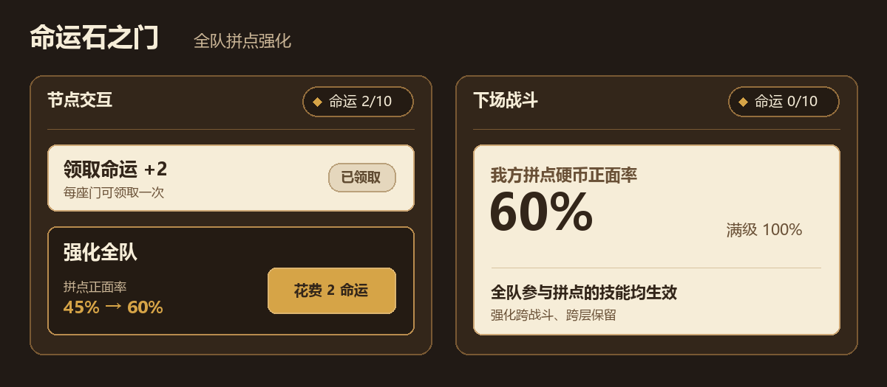

# 命运系统方案

适用单机林地探索。命运最多存 10 点，跨层保留。我方每枚拼点硬币的正面率从 45% 起步，满级达到 100%。命运石之门既给命运，也能用命运强化全队。下文的奖励量、升级费用和中间档位为首测试值。

## 怎么玩

「命运」由全队共享，开局 0 点。玩家可以在命运石之门稳定领取，也可以通过实际探索行动或战斗胜利随机获得。

| 行动 | 获得 1 点的概率 |
| --- | ---: |
| 首次抵达哨塔，或首次完成神龛选择 | 30% |
| 击败普通战斗节点的敌人 | 20% |
| 击败精英节点的敌人 | 35% |
| 击败关底首领 | 50% |

每个合格节点或遭遇只判一次，落空也用掉这次机会。巡逻遭遇、重复经过、打开或取消弹窗、战败均不判定。满额时随机收益溢出部分舍弃。命运独立于 Cost、行动骰、战后选卡和现有战利品。

## 命运石之门

建议每层保底一座。首层的门放在首场必打战前可达的路线，让玩家有机会先把正面率从 45% 拉到 60%。

- **领取命运**。每座门可领一次，获得 2 点。满额时可以先升级腾出空间再领。只剩 1 个空位时，确认前显示本次只会获得 1 点。
- **强化全队**。消耗命运提高一档正面率，当次到访可以先领取再升级，也可以连续升档。离开后可以回来继续升级，领取次数按门记录。每次确认显示当前正面率、升级后正面率和花费。达到 100% 时显示「已满级」。余额不足、已满级、取消或重复提交时，无扣费或升级。

| 全队拼点硬币正面率 | 升到这一档消耗 |
| --- | ---: |
| 45% | 开局 |
| 60% | 2 点 |
| 75% | 3 点 |
| 90% | 4 点 |
| 100% | 5 点 |

强化写入本次探索，跨战斗、跨层和换队员都保留。全队所有参与真实拼点的技能共用这一档自然正面率，达到 100% 后每枚自然拼点硬币必出正面，最终仍按双方威力判胜。铅币与角色转正按各自规则处理。敌方仍为 50%，单方面攻击、拼赢后的伤害掷币、平局与压制保留当前规则。新开探索时，余额归零，正面率回到 45%。

以双方基础威力和硬币威力相同、各有两枚正收益硬币、平局重掷为例，敌方每枚正面率为 50%。我方正面率为 45%／60%／75%／90% 时，整场拼赢率约为 **42.4%／64.7%／83.1%／95.4%**。首轮记录玩家在哪一层升到 90% 和 100%，并比较升档前后的结果。

## 界面预览

地图顶栏显示命运余额，命中的随机奖励写入探险手记。命运石之门同时展示领取和强化。战斗规划区显示当前「我方拼点正面率」，队伍在正常规划流程中自动享受强化。

## 接入顺序与验收

1. **地图入口。** 在 `ForestMapGraph.NodeKind` 新增门的类型，保持已有枚举值。由 `ForestRandomGenerator.generate()` 用现有节点元数据设置入口，保留其他保底节点。同步 `map_visuals.gd` 的徽章和 `exploration_map.gd` 的节点弹窗。用固定种子检查首层可达性、后续门的分布及原有出口路径。
2. **账本与交易。** `ForestRun` 管余额、强化档位和奖励记录。从哨塔、神龛和战斗胜利的现有结算接入独立随机流。领取用楼层与节点标识去重，升级确认校验处于门内、预期档位和余额后一次写入。测试落空、满额、重复进入或提交、领取后立即升级、跨层和重开。
3. **拼点。** `planning_ui.gd::new_battle()` 经探索开战配置传入当前全队正面率，`DemoBattleRules._clash()` 将它用于我方掷币。显式处理 100% 边界，用可控随机覆盖随机值恰为 1 时仍出正面。也验证满级我方仍会输给威力更高的牌，以及满级后的升档请求不扣点。覆盖每个成员、连掷、重掷、铅币和 ZiXi 转正。战斗结束只由探索侧结算命运掉落。单场、木桩和好友对战用现有默认概率。
4. **平衡。** 固定阵容、牌序和敌组对照目前 65% 与新的成长曲线，记录首门前败率、每层到门时余额、常见升级档位及通关率。优先验证首层拿不到升级时的可玩性，再比较少人与三人队、单币与多币牌。

当前实现入口与测试索引见[代码速查](../代码速查/代码全景与模块指南.md#拼点概率与探索奖励)。
