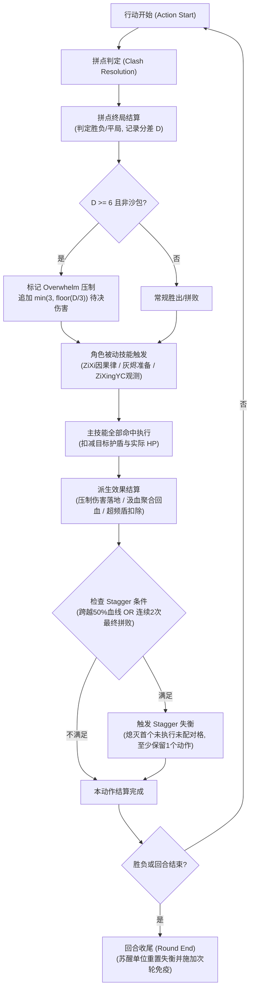

# 阶段 1 · 战斗演进规则合同与界面预览

> **关联基线**：Commit `308657b`（Godot 4.7.2，全 21 项测试通过，工作区纯净）  
> **派发来源**：[`docs/协作指南/战斗演进审查与阶段提示词.md`](../协作指南/战斗演进审查与阶段提示词.md) 阶段 1  
> **产出性质**：**只读规则合同与视觉预览**（本阶段不修改任何生产代码）

---

## 一、审查结论解决与分类清单

对照审查意见与基线实测，我们解决原案中的分歧，并将所有设计项严密收敛为三类：

### 1. Must Change（必须调整项）

| 系统 | 原案风险点 | 必须调整的规则合同（Must Change） |
| :--- | :--- | :--- |
| **失衡触发** | 原案中“一回合两败”与“连续两败”、“回合/层内血线”定义冲突，且会全熄灭导致被连续秒杀。 | ① **判定源**：只以**最终拼败**计数（单次破币或平局重掷不计）；<br>② **血线限定**：`前HP ≥ 50% 且 后HP < 50%`，每单位**每战至多一次**；<br>③ **触发时机**：整次技能全部命中执行完毕后统一判定；<br>④ **保护垫**：仅熄灭时间线上首个未执行未配对动作，玩家**全回合至少保留 1 个已锁定动作**；Boss 保留行动；<br>⑤ **苏醒免疫**：次轮解除失衡后，获得 **1 回合再次失衡免疫期**。 |
| **压制结算** | 原案无上限穿透又削减速度，产生不可逆的先手滚雪球。 | ① 整场拼点**至多判定一次**（以决胜最后一掷为准）；<br>② **伤害封顶且可抵盾**：$D = 胜者 - 败者 \ge 6$ 时，追加伤害为 $\min(3, \lfloor D / 3 \rfloor)$；<br>③ **排除特例**：训练沙包与纯防御牌获胜不结算压制；<br>④ **暂缓速度惩罚**：首轮不降速，单独隔离压制伤害影响。 |
| **回响机制** | 锁定后一次性结算无法进行第二次选牌，无界递归会导致期望后代失控。 | ① **首版采用有界自动余波**：仅对普通单目标攻击、主目标仍存活时判定；<br>② **参数约束**：$25\%$ 概率触发，造成主目标实损 HP 的 $35\%$；<br>③ **频率上限**：全队每回合**至多生成一次**；不继承触发、不复制费用与附魔。 |
| **词条与经济** | 汲血复算面板会因魔理沙火花或沙包严重膨胀；超频盾账不清。 | ① **汲血真实扣算**：以主技能最终实损 HP 的 $15\%$ 为基准，单次动作**回复上限为 5 HP**；<br>② **超频精准献祭**：行动开始时实际扣盾，每完整消耗 4 盾增伤 $15\%$，**上限消耗 8 盾 (+30% 增伤)**；<br>③ **轻灵保底**：有效费用 $-1$，但**最低为 1 Cost**（原 0 费保持 0）。 |
| **遗物与连携** | 消耗品 ID 无法常驻；原有牌表缺少指定加盾或独立虚弱状态。 | ① 消耗品 ID 不混入永久套装部件，剔除无效三件套引用；<br>② 明确连携激活为每队每回合至多一次，且基于现存合法触发源（如秒表拼胜挂标记、封魔阵拼胜给灰烬加蓄势）。 |
| **演出节奏** | 破币外层叠等待会导致高倍速（×4）严重拖沓滞后。 | ① 严禁修改 `Engine.time_scale`，演出倍速走局部时钟；<br>② 决胜帧顿挫直接复用 `_contact()` 的 0.30s 停留预算，×4 下将顿挫微震压入 1 帧并与动作融合。 |

---

### 2. 首轮试验值（First-Round Experimental Values）

- **失衡阈值**：$50\%$ 生命线；连续最终拼败 $2$ 次；失衡期间后续受击额外承受 $+20\%$ 伤害（按段向下取整）。
- **压制差额**：$D \ge 6$；伤害公式 $\min(3, \lfloor D / 3 \rfloor)$；伤害可被护盾正常抵扣。
- **锻台消费**：单次附魔消耗固定 **$4$ Cost**；每卡限拥有 $1$ 个符文，覆盖旧词条时不退费。
- **5 符文参数**：
  1. `rune_feather`：Cost $-1$（下限 $1$）。
  2. `rune_leech`：实损 HP 的 $15\%$ 治疗（上限 $5$ HP）。
  3. `rune_impact`：基础点数 $+1$（保留原平局判定规则）。
  4. `rune_echo`：$25\%$ 几率触发 $35\%$ 实损余波（全队每回合限 $1$ 次）。
  5. `rune_overcharge`：每消耗 $4$ 盾 $+15\%$ 伤（上限消耗 $8$ 盾，最高 $+30\%$）。

---

### 3. 可延后项（Deferred Items）

1. **压制削减下回合速度**：暂缓实装，待第一轮承伤数据稳定后再评估。
2. **手牌型回响的临时 0 费手牌再规划**：延后至有独立的再规划状态机与额外行动额度框架后再立项。
3. **遗物首轮附加敌方疑虑速度 -2**：暂缓实装，避免干扰开局拦截窗口。

---

## 二、结算时序与生命周期状态机



### 数值取整与预算规则
- **HP / Cost / Shield 统一整数法则**：所有百分比浮点计算结果一律采用 `floor()`（向下取整，`int()` 截断）。
- **单次技能事件预算**：汲血、回响、压制等派生效果全部以该技能在 `events` 列表中聚合的 `damage`（实际扣减 HP）为输入，绝不直接乘以技能面板初始伤害。

---

## 三、关键状态流转图

### 1. 血线失衡与苏醒免疫周期
```
[健康状态 100%~50%] 
       │
       ▼ (受创跌破 50% 刻度线)
[触发 BREAK 失衡] ────► 熄灭时间线首个空闲动作 ────► 受击易伤 +20%
       │
       ▼ (下一回合开始)
[从失衡中苏醒] ────► 挂载【失衡免疫 1 回合】 ────► 无法在此回合再次被破防
       │
       ▼ (第三回合开始)
[免疫期结束，恢复正常判定]
```

### 2. 少人队行动格与保护垫
```
[玩家行动格队列 (如灰烬 1人队: 3格)]
 格1 (已锁定迎击敌人A) ──► 【受保护】必须执行拼点，防止沦为单方面受击
 格2 (空闲未配对攻击)   ──► 【触发失衡时优先熄灭】退还预留 Cost
 格3 (防御保底动作)     ──► 【受保护】全回合至少保留 1 个动作供玩家周旋
```

---

## 四、界面与关键帧预览索引

预览组件已完整实装于交互式 HTML 页面：  
🔗 [docs/任务记录/视觉预览/战斗演进界面预览.html](视觉预览/战斗演进界面预览.html)

### 包含的三大核心模块：
1. **余烬锻台雕琢界面**：
   - 左侧展示队伍有效卡牌，右侧展示 5 大符文。
   - 清楚呈现当前附魔状态、消耗 4 Cost 提示与旧词条覆盖确认。
2. **失衡血条与行动格保护垫**：
   - 50% 血量红色刻度线与 `【BREAK 失衡】` 破碎徽标。
   - 明确展示哪些格被熄灭并退费、哪些格受保底保护继续执行。
3. **终极符卡切镜横幅（Cut-in Banner）关键帧**：
   - 演示斜切暗金色发光横幅与聚光暗化效果。
   - 支持实时切换 ×1 (250ms) / ×2 (125ms) / ×4 (60ms) 的演出倍速适配。

---

## 五、请用户确认的三组决策事项

为确保后续实装（阶段 2 起）精准符合预期，请确认以下三项核心取舍：

### 决策组 1：失衡保护垫与 Boss 机制
- **提案**：失衡触发时，只熄灭首个未配对的动作，并确保玩家队伍全回合至少保留 1 个可执行动作；对单 Boss（如 210 HP 巨像）不熄灭行动，仅施加受击易伤 +20%。
- **选择**：`[A] 赞成提案（推荐，避免双方暴毙）` / `[B] 严酷模式（失衡全格熄灭，包括Boss）`。

### 决策组 2：回响机制与遗物三件套部件
- **提案**：
  - 回响首版采用“25% 几率造成主目标 35% 实损余波”（避免再规划导致回合事件锁死）。
  - 遗物三件套中，由于原案的 `ember_catalyst`（催化剂）与 `weighted_coin`（铅币）在游戏内属于一次性消耗道具，三件套仅收纳永久被动遗物（或补充新的永久遗物 ID）。
- **选择**：`[A] 赞成提案（推荐，规则与数据结构自洽）` / `[B] 必须做手牌型复制（需要单独立项再规划阶段）`。

### 决策组 3：演出表现与倍速模式
- **提案**：拼刀顿挫 (0.06s) 和大招横幅 (0.25s) 采用无缩放时钟，在演出 ×4 模式下自动并入动作帧（顿挫并入接触帧，横幅缩至 60ms 与施法合一），保证战斗爽快度不被拖长。
- **选择**：`[A] 赞成提案（推荐，兼顾打击感与刷图效率）` / `[B] 倍速下依然完整等待演出时长`。
