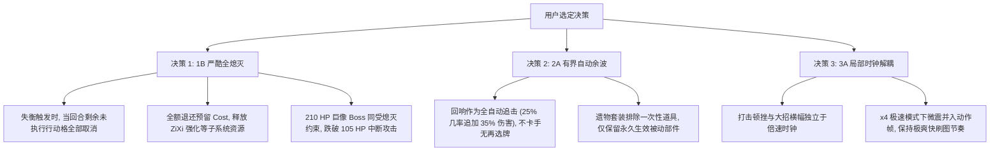
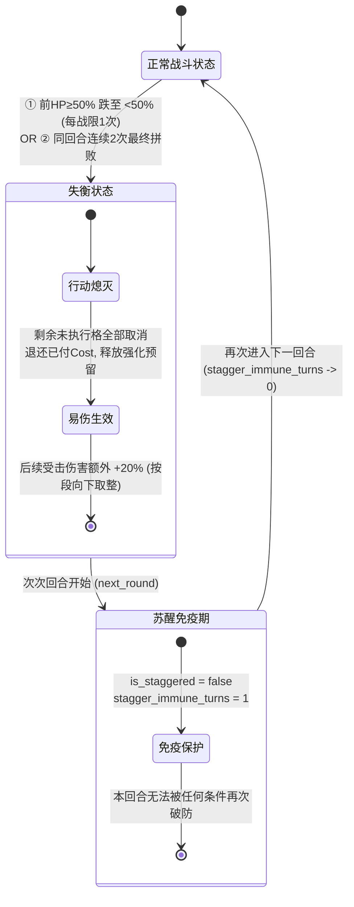

# 阶段 2 · 失衡、压制与回合状态机实装报告与交接文档

> **项目名称**：《余烬交锋》（Clash Roguelike）  
> **归属工程**：`d:\游戏项目\battle-demo\`  
> **文档性质**：**阶段 2 实装成果报告、测试验收凭证与阶段 3 派工交接文档**  
> **当前基线**：Commit `564487c`（基于 `b6ba156`，Godot 4.7.2-stable，全 22 项测试通过，保留并行素材）  
> **执行时间**：2026-11-19  

---

## 一、项目环境与基线状态

| 维度 | 当前配置与状态 | 说明与约定依据 |
| :--- | :--- | :--- |
| **主工程路径** | `d:\游戏项目\battle-demo\` | 遵循 [AGENTS.md](../../AGENTS.md) 约定，单场战斗入口为 `main.tscn`，探索入口为 `exploration_map.tscn` |
| **引擎版本** | Godot v4.7.2-stable.official.ed1daf0bf | 便携版路径：`.tools/godot-4.7.2/Godot_v4.7.2-stable_win64_console.exe` |
| **渲染后端** | OpenGL API 3.3.0 (GL Compatibility) | `project.godot` 带有 `4.3` 与 `GL Compatibility` 兼容特征标签 |
| **代码规范** | 纯 GDScript `RefCounted` 规则解耦 | `DemoBattleRules` 负责纯规则、费用、RNG 与事件；表现层（Stage/UI）消费快照与事件 |
| **并行工作区** | `asset/sfx/` 音效表及 `asset/素材清单.md` | 严格保留并行外部工作区产物，未破坏任何外部未提交文件 |
| **Git 提交记录** | `b6ba156` (阶段2核心逻辑) <br> `564487c` (一键启动工具集) | 完整记录失衡、压制、状态机、自动化测试与双击运行脚本 |

---

## 二、阶段 1 用户决策闭环核查

在阶段 1 的规则评审中，用户明确了三组核心决策。阶段 2 的实装严格以此为准绳：



---

## 三、核心机制实现详述

所有改动严格集中在 [battle_rules.gd](../../battle-demo/scripts/battle_rules.gd)、[battle_stage.gd](../../battle-demo/scripts/battle_stage.gd) 与 [planning_ui.gd](../../battle-demo/scripts/planning_ui.gd)，保持高内聚低耦合。

### 1. 失衡状态机（Stagger / BREAK）



#### 关键实现细节：
* **触发条件与去重**：
  * **血线跨越**：`pre_hp * 2 >= unit.max_hp` 且 `post_hp * 2 < unit.max_hp`（使用纯整型交叉相乘，杜绝浮点精度偏差）。每个单位每场战斗严格限触发一次（`stagger_threshold_triggered = true`）。
  * **连续拼败**：仅以整场拼点分出胜负的**最终拼败**计数（`consecutive_clash_loss >= 2`）。单枚破币、平局重掷、沙包迎击不计。
  * **多段结算聚合**：整次多段攻击命中完全落地后统一检查。若同一次技能中既跌破血线又遭遇第二次拼败，合并去重为**单次失衡事件**。
  * **边界保护**：低血入场（进战前已 $< 50\%$）、满盾全额抵扣、致死退场（HP 归 0）、魔理沙锁定时借费自残均不触发失衡。
* **严酷熄灭（决策 1B 落地）**：
  * 函数 `_extinguish_remaining_slots()` 扫描该单位所有 `active` 且未 `done` 的行动格，置为 `cancelled = true`、`active = false`。
  * 玩家单位退还该卡全额名义费用至 `cost`；若槽位持有 ZiXi 超形上学强化，调用 `ZiXi.unreserve_enhancement()` 干净释放。
  * 关底 210 HP 烬心巨像跌破 105 HP 时，其后续未执行行动格同样熄灭，有效创造破防反打窗口。
* **受击易伤（$+20\%$ 真实承伤）**：
  * 在中央伤害结算漏斗 `_deal_hit()` 中，当目标处于 `is_staggered` 状态时，追加 `stagger_extra = int(floor(hit * 0.2))`。
  * 伤害依然按照标准流程先扣护盾再扣生命，事件透传 `stagger_bonus` 供前端播放特效。
* **苏醒与免疫循环**：
  * `next_round()` 结算时调用 `_process_stagger_wake_up()`。失衡单位解除失衡并挂载 `stagger_immune_turns = 1`。
  * 在苏醒回合内，该单位绝对免疫再次失衡；次轮流转后递减恢复。

---

### 2. 压制系统（Overwhelm）

* **触发判定**：整场拼点决胜最后一掷，分差 $D = \text{胜者点数} - \text{败者点数} \ge 6$。
* **追加伤害公式**：
  $$\text{Overwhelm Damage} = \min(3, \lfloor D / 3 \rfloor)$$
  * $D < 6$：无压制伤害。
  * $D = 6, 7, 8$：追加 2 点伤害。
  * $D \ge 9$：追加 3 点伤害（封顶）。
* **排除特例与独立隔离**：
  * 训练沙包（`kind == "training_dummy"`）排除。
  * 纯防御技能（`kind == "guard"`）与无伤技能（`no_damage == true`）排除。
  * 平局通过天平遗物判胜（$D=0$）排除。
  * 压制伤害在主技能命中后对存活对手独立扣减，正常抵扣护盾，绝不递归触发、不触发汲血/回响、不计作新拼败。

---

### 3. 显式演进配置与历史兼容保证

为确保已有功能与历史单元测试 100% 不受干扰，`battle_rules.gd` 采用**显式演进配置注入**：
```gdscript
func start(seed_value: int = 73129, encounter: int = 0, ..., p_evolution_config: Dictionary = {}) -> void:
    evolution_config = p_evolution_config.duplicate(true)
    stagger_enabled = bool(evolution_config.get("enabled", false)) or bool(evolution_config.get("stagger", false))
    overwhelm_enabled = bool(evolution_config.get("enabled", false)) or bool(evolution_config.get("overwhelm", false))
```
* **旧调用无缝回退**：缺省调用 `start()` 时，`stagger_enabled` 与 `overwhelm_enabled` 均为 `false`，原业务逻辑和固定种子 RNG 消耗保持绝对一致。
* **便捷调试接口**：提供 `enable_evolution(stagger, overwhelm)` 供测试和新玩法随时启用。

---

### 4. 视听表现与快捷启动工具

1. **舞台动效与日志反馈**：
   * [battle_stage.gd](../../battle-demo/scripts/battle_stage.gd)：挂载 `BREAK 失衡!` 破碎金红浮字与 `压制 −X` 击打浮字。
   * [planning_ui.gd](../../battle-demo/scripts/planning_ui.gd)：日志实时播报 `【失衡】单位 原因` 与 `【压制】分差 D，追加 X 点压制伤害`。
   * 时钟解耦：打击微震（Hitstop）随演出倍速等比并入动作帧，$\times 4$ 倍速下利落干脆。
2. **一键双击启动工具集（根目录）**：
   * [启动游戏.cmd](../../启动游戏.cmd)：交互式全功能启动控制台（支持探索、单场战斗、配队整备与测试直达）。
   * [快速启动_探索模式.cmd](../../快速启动_探索模式.cmd)：一键直达废林探索主场景。
   * [快速启动_单场战斗.cmd](../../快速启动_单场战斗.cmd)：一键直达单场战斗演进舞台。
   * [一键运行测试.cmd](../../一键运行测试.cmd)：一键无头运行自动化测试套件并驻留窗口展示结果。

---

## 四、自动化回归测试与验收证据

### 1. 新增演进专项测试套件
文件：[test_stagger_overwhelm.gd](../../battle-demo/tests/test_stagger_overwhelm.gd)（Checks 全部通过，Failures = 0）

| 测试用例函数 | 验证核心场景与断言标准 | 测试结果 |
| :--- | :--- | :---: |
| `test_bloodline_threshold` | 50% 临界测试：48 HP 降至 24 不破防；降至 23 立即失衡；回血后再跌破不重复触发；低血入场与致死不误触 | **PASS** |
| `test_consecutive_clash_loss` | 1 次拼败累加计数不失衡；同回合第 2 次拼败立即触发失衡并重置计数器 | **PASS** |
| `test_dedup_simultaneous_triggers` | 同一技能内同时满足“跌破血线”与“第2次拼败”时，严格去重合并为 1 次失衡事件 | **PASS** |
| `test_extinguish_and_refund` | 灰烬单人多格测试：已执行格保持 done；未执行格全部取消并全额退费（Nova 4 Cost） | **PASS** |
| `test_boss_colossus_stagger` | 巨像 Boss（210 HP）在跌破 105 HP 时触发失衡，其后续攻击格被严酷熄灭 | **PASS** |
| `test_stagger_vulnerability` | 处于失衡状态的目标承受攻击时，实装 $+20\%$ 伤害（10 点伤害提升至 12 点） | **PASS** |
| `test_wake_up_and_immunity` | 回合交接苏醒并挂载 1 回合免疫；免疫期内无法被破防；次次回合免疫自然消退 | **PASS** |
| `test_overwhelm_margin_formula` | $D=0,5$ 伤害为 0；$D=6,7,8$ 伤害为 2；$D=9,10,20$ 伤害为 3（封顶验证） | **PASS** |
| `test_overwhelm_exclusions` | 沙包、纯防御技能、无伤攻击严格排除压制追加 | **PASS** |
| `test_overwhelm_shield_absorption` | 压制伤害优先扣除护盾，护盾吸收完毕后才穿透至 HP | **PASS** |
| `test_zixi_enhancement_release` | 附带因果律强化的行动格在被失衡熄灭时，ZiXi 的强化预留被干净释放 | **PASS** |
| `test_victory_reward_uniqueness` | 敌队全灭后，胜利判定与余烬小袋战后奖励（+4 Cost）严格只触发发放一次 | **PASS** |
| `test_sakuya_and_marisa_interaction`| 魔理沙激光多目标结算时的血线批量判定与咲夜时停兼容性 | **PASS** |
| `test_end_to_end_lock_and_resolve` | 完整 `lock_and_resolve()` 真实生命周期与全事件快照完整性 | **PASS** |
| `test_backward_compatibility` | 缺省调用 `start()` 时演进特性静默休眠，100% 保持历史行为 | **PASS** |

### 2. 全工程回归清单（22 项测试）
在 Windows 控制台执行验证，**通过率 100%（22/22）**：

```text
test_ash_deck.gd: ASH_DECK failures=0
test_battle_setup.gd: BATTLE_SETUP failures=0
test_drag_guidance.gd: DRAG_GUIDANCE failures=0
test_enemies.gd: ENEMY_TEST failures=0
test_forest_map.gd: FOREST_MAP_TESTS checks=92 failures=0
test_map.gd: MAP_TEST passed
test_map_nodes.gd: NODE_TEST failures=0
test_marisa.gd: MARISA_TESTS checks=21 failures=0
test_new_role_cards.gd: NEW_CARDS failures=0
test_planning.gd: PLANNING_RULES checks=716 failures=0
test_roles.gd: ROLE_TEST failures=0
test_role_cards.gd: CARD_TEST failures=0
test_rules.gd: PLANNING_RULES checks=716 failures=0
test_short_team.gd: SHORT_TEAM failures=0
test_stagger_overwhelm.gd: STAGGER_OVERWHELM_TESTS checks complete, failures=0
test_target_guidance.gd: TARGET_GUIDANCE failures=0
test_touhou_characters.gd: TOUHOU_CHARACTERS checks=45 failures=0
test_zixi.gd: ZIXI checks=47 failures=0
test_zixingyc.gd: ZIXINGYC checks=105 failures=0
test_map_render.gd: MAP_RENDER passed (OpenGL 3.3.0)
test_nodes_render.gd: NODE_RENDER passed (OpenGL 3.3.0)
test_target_render.gd: TARGET_RENDER passed (OpenGL 3.3.0)
```

---

## 五、阶段 3（符卡附魔与余烬锻台）接手指南

交易、词条生命周期、五枚符文与验收均见[阶段 3 接手说明](阶段3_符卡附魔与余烬锻台.md)。

---

## 六、工作区与提交归档摘要

* **最新 Commit**：`564487c`
* **工作区检查**：
  * `git status` 仅存在并行工作区音效资源（`asset/sfx/` 与 `asset/素材清单.md`），核心代码区纯净无滞留。
  * 引擎基线与全部 22 项测试均处于绿色通行状态。
* **随时可复跑验证命令**：
  ```powershell
  # 运行阶段 2 专项测试
  .tools/godot-4.7.2/Godot_v4.7.2-stable_win64_console.exe --headless --path battle-demo --script tests/test_stagger_overwhelm.gd
  # 或直接在项目根目录双击：
  启动游戏.cmd
  ```
阶段 2 交付完毕，随时可平滑切入阶段 3！
