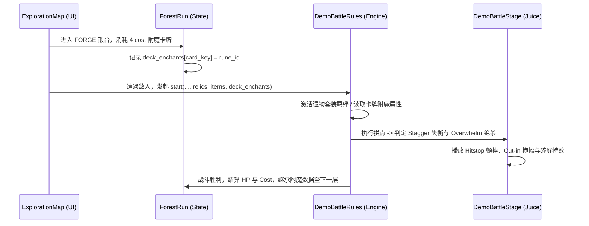

# 战斗深度、符卡附魔与视听演进设计方案

> **文档标识**：`DESIGN-2026-COMBAT-AUGMENT-JUICE`  
> **基线版本**：Commit `5957254`（Godot 4.7.2 稳固分支，10套自动化测试 100% 通过）  
> **面向模块**：
> - 模块一：战斗与拼点机制的深度升维 (Combat Mechanics)
> - 模块二：局内深度构筑与符卡附魔 (Deck Augmentation)
> - 模块四：视听审美与演出反馈 (Juice, Polish & Aesthetics)

---

## 1. 架构总览与设计目标

### 1.1 现状与痛点
当前原型已具备完整的拼点肉鸽骨架（节点图探索、8位可选英雄、战前行商、关底首领石门、多层深入机制）。但在战斗体验上仍有以下提升空间：
1. **决策单调性**：拼点交互主要依赖硬币正反面比大小，缺少“集中爆发击破敌方破绽”的战术拐点。
2. **构筑深度受限**：余烬锻台目前仅提供基础属性提升，缺乏对单个技能符卡的深度定制，后期流派缺乏质变感。
3. **视听反馈偏平**：高费用终极符卡缺乏仪式感，激烈拼刀缺少顿挫停顿（Hitstop）与动态镜头反馈。

### 1.2 目标体验
打造兼具**战术策略性**（通过失衡与连携创造高光斩杀回合）、**流派构筑自由度**（通过锻台附魔与遗物羁绊产生质变构筑）以及**日系暗黑幻想视听张力**（拼刀特写、大招横幅切入、碎裂打击感）的核心战斗循环。

---

## 2. 模块一：战斗与拼点机制的深度升维 (Combat Mechanics)

### 2.1 失衡破防系统 (Stagger / Break Threshold)
借鉴《Limbus Company》与《只狼》的失衡躯干设计，在血量对抗之上建立战术破防维度。

#### 规则与数值逻辑
1. **失衡判定条件**（满足任意一项触发）：
   - **血量刻度突破**：当单位生命值在当回合首次跌破 **50%** 时，触发即时失衡。
   - **拼点连续挫败**：单回合内同一单位连续拼点失败达到 **2 次**。
2. **失衡状态效果（持续 1 回合）**：
   - **打断行动**：该单位当回合剩余的所有行动格立即熄灭，无法出牌，无法进行反击判定。
   - **防御瓦解**：单位现有护盾清零，受到的一切攻击判定为 **暴击伤害（150% 真实伤害）**。
   - **视觉提示**：头顶悬挂碎裂盾牌标记 `【BREAK 失衡】`，伴随角色受击硬直动画。
3. **恢复机制**：
   - 下一回合开始时，该单位从失衡中苏醒，重新投掷速度骰子与行动格，失衡计数器清零。

#### 数据结构扩展 (`DemoBattleRules`)
```gdscript
# 在英雄和敌怪的单元字典中新增字段：
{
    "stagger_threshold": 0.5,     # 50% 血量阈值
    "stagger_triggered": false,   # 当前层是否已触发过血量失衡
    "consecutive_clash_loss": 0,  # 连续拼点失败计数
    "is_staggered": false,        # 是否处于失衡状态
    "stagger_turns_left": 0       # 失衡剩余回合
}
```

---

### 2.2 绝对压制机制 (Clash Overwhelm)
避免大优势拼点仅获得微小数值收益，鼓励高额点数压制。

#### 规则逻辑
- 当单次拼点胜出且 **胜者点数 − 败者点数 ≥ 6 点** 时，判定为 **「压制绝杀 (OVERWHELM)」**。
- **压制奖励**：
  1. 额外追加 `(点数差额) × 1` 点不可被护盾抵扣的穿透反噬伤害。
  2. 败者下回合的速度上限降低 1 点（例如 3~6 降为 3~5）。
  3. 视听上触发强烈的全屏慢放与碎屑打击特效。

---

### 2.3 队伍同调连携共鸣 (Team Resonance Combos)
当特定阵营或机制的角色在同一回合共同行动时，触发被动共鸣增益：

| 连携名称 | 触发阵容组合 | 激活条件 | 共鸣强化效果 |
| :--- | :---: | :--- | :--- |
| **红魔时空协同** | 咲夜 + 魔理沙 | 咲夜成功施加虚弱，且魔理沙当回合打出攻击牌 | 魔理沙攻击基础威力 **+4**，若击杀目标则返还 2 点 Cost。 |
| **博丽坚壁蓄势** | 灵梦 + 灰烬 | 灵梦为灰烬提供护盾，或灵梦使用结界卡 | 灰烬立即获得 **1 层【蓄势】**，下回合基础速度 +1。 |
| **破阵绝锋连刺** | 灰烬 + 长锋 | 灰烬造成重击后长锋接续攻击同一目标 | 长锋该次攻击穿透目标全部护盾，直接造成真实生命伤害。 |
| **超形因果反思** | ZiXi + ZiXingYC | ZiXi 触发因果律，或 ZiXingYC 整理记忆 | ZiXingYC 立即补满 1 份缺失语料；ZiXi 下次硬币判定保底正面。 |

---

## 3. 模块二：局内深度构筑与符卡附魔 (Deck Augmentation)

### 3.1 余烬锻台的符文附魔雕琢 (Rune Sockets)
将地图节点 `FORGE`（余烬锻台）升级为支持个性化卡牌改造的工坊。

#### 交互与经济规则
- 在锻台界面，玩家可消耗 **4 Cost** 选择卡组中任意 1 张牌附魔 1 种符文。
- 每张卡牌最多拥有 1 个附魔词条。重复附魔将覆盖旧词条。
- 附魔数据存储于 `ForestRun.deck_enchants: Dictionary`（键为 `card_key`，值为 `rune_id`），在多层探索中永久继承。

#### 5 大核心符文设计

```
[轻灵符文 🪶] Cost −1 ──── 降低卡费门槛，大招提前启动
[汲血符文 🩸] 伤害30%回血 ── 解决少人队伍续航问题
[破势符文 🔨] 基础点数+2 ── 平局必胜，关键交锋攻坚
[回响符文 🔔] 50%生成0费复制 ─ 飞刀/轻卡流连击爆发
[超频符文 ⚡] 献祭护盾增伤 ── 盾击流与高防流转化暴力输出
```

1. **轻灵符文 (`rune_feather`)**：
   - 效果：该符卡 Cost 消耗永久 **−1**（最低为 0）。
2. **汲血符文 (`rune_leech`)**：
   - 效果：该卡命中造成的最终伤害中，**30%** 转化为对全队生命值最低存活队员的生命恢复。
3. **破势符文 (`rune_impact`)**：
   - 效果：拼点基础点数 **+2**；若拼点点数完全相同，**打破平局必定判定我方胜出**。
4. **回响符文 (`rune_echo`)**：
   - 效果：打出该卡命中后，有 **50% 概率**将一张本回合 0 费的虚影复制卡临时加入手牌。
5. **超频符文 (`rune_overcharge`)**：
   - 效果：打出时清空释放者自身全部护盾，每献祭 4 点护盾，该技能造成的最终伤害提升 **+30%**。

---

### 3.2 遗物羁绊套装 (Relic Synergies)
让散落的通用遗物产生组合共鸣，鼓励多样化战术收集：

#### 套装 1：【余烬狂欢】（余烬三件套）
- **组成组件**：`everburning_tinder` (永燃火种) + `ember_catalyst` (余烬催化剂) + `ember_pouch` (余烬小袋)
- **羁绊特质**：
  - 每场战斗第 1 回合，队伍打出的**首张符卡 Cost 消耗减半**（向上取整）。
  - 战斗胜利结算时获得的 Cost 额外增加 **+50%**。

#### 套装 2：【天命在握】（命运博弈套）
- **组成组件**：`mercury_die` (水银骰子) + `weighted_coin` (特制铅币) + `weight_of_balance` (天平之重)
- **羁绊特质**：
  - 拼点掷硬币时，每个单位的第一枚掷出反面的硬币自动获得 **1次【命运重掷】**。
  - 战斗开始时，随机使 1 名敌怪进入【疑虑】状态（首轮速度 -2）。

#### 套装 3：【荒野行者】（生存探索套）
- **组成组件**：`brass_compass` (黄铜罗盘) + `ranger_cloak` (游侠斗篷) + `trail_rations` (荒野干粮)
- **羁绊特质**：
  - 探索中全员每前进一步自然恢复 **1 点生命**。
  - 地图上所有营地与神龛的效果数值提升 **+25%**。

---

## 4. 模块四：视听审美与演出反馈 (Juice, Polish & Aesthetics)

针对高品质日系暗黑幻想画风，细化视觉与节奏动效。

### 4.1 拼刀微顿挫与冲击震屏 (Clash Hitstop & Screen Shake)
- **顿挫触发机制 (Hitstop)**：
  - 当双方拼点交锋分差 ≤ 2（胶着拼刀）或触发压制（Overwhelm）时，胜负决出判定帧触发 **0.06 秒瞬时微定格**。
  - 逻辑定时器采用无缩放时钟，不受演出倍速（`speed = 2.0 / 4.0`）的逻辑畸变影响。
- **冲击波与镜头抖动**：
  - 在两张卡牌交击的几何中点爆发圆形冲击波光环（Shockwave Ring），并在 0.2 秒内半径扩张至 40px 淡出。
  - 屏幕施加水平与垂直振幅为 3~4px 的衰减正弦微震（持续 0.15 秒）。

### 4.2 终极符卡切入横幅 (Spellcard Cut-in Banner)
- **触发条件**：打出基础费用 ≥ 4 的终结卡（如魔理沙 `spark`、咲夜 `def_killing_doll`、灰烬 `nova`）。
- **动效表现**：
  - 画面上 1/3 区域横向滑入一条带有 15 度斜切的暗金高光半透明横幅（高度 64px）。
  - 横幅左侧呈现角色名，右侧为发光大号楷体符卡名（例如：`【雾雨魔理沙】· 恋符「Master Spark」`）。
  - 战斗舞台背景整体下调亮度 30% 并施加聚光晕光（Spotlight），蓄力 0.25 秒后贯穿出全屏弹幕光束。

### 4.3 失衡破碎与暴击数字飘字 (Break FX & Floating Numbers)
- **失衡碎裂**：
  - 敌人失衡瞬间，血条上方炸开 8~12 片深灰/赤红的多边形碎晶粒子，向下加速度下坠。
- **数字排版**：
  - 普通伤害：白底黑边（18pt）。
  - 克制/有效伤害：金黄字体（22pt）。
  - 失衡暴击伤害（150%）：**赤红渐变烈火字体（28pt，带向上抛物线弹跳与轻微放大缩放反馈）**。

---

## 5. 系统数据流与兼容性设计



### 兼容性保障准则
1. **现有 API 完全兼容**：
   - `DemoBattleRules.start(...)` 在保留原有签名的基础上增加可选参数 `deck_enchants: Dictionary = {}`。
   - `ForestRun.advance_to_next_floor(...)` 自动持久化并继承 `deck_enchants`。
2. **测试驱动安全网**：
   - 现有的 10 个测试文件（包括 `test_forest_map.gd`、`test_battle_setup.gd`、`test_rules.gd` 等）必须保持 100% 零故障。
   - 为 Stagger、Overwhelm、5大符文和套装羁绊各编写专属单测。

---

## 6. 分阶段推进路线图

| 阶段 | 核心任务 | 交付物 | 验收标准 |
| :---: | :--- | :--- | :--- |
| **阶段 1** | 数值与规则层实装 | `battle_rules.gd` 新增失衡、压制、符文词条逻辑 | 自动化单元测试 100% 通过，无死循环无数值溢出 |
| **阶段 2** | 探险锻台与构筑持久化 | `forest_run.gd` & `exploration_map.gd` 锻台附魔交互 | 锻台可选择符文雕琢，多层探索中附魔完全保留 |
| **阶段 3** | 视听打击感与演出抛光 | `battle_stage.gd` 顿挫、横幅切入、碎晶与暴击飘字 | ×1/×2/×4 倍速下平滑运行，画面张力与节奏感显著提升 |
