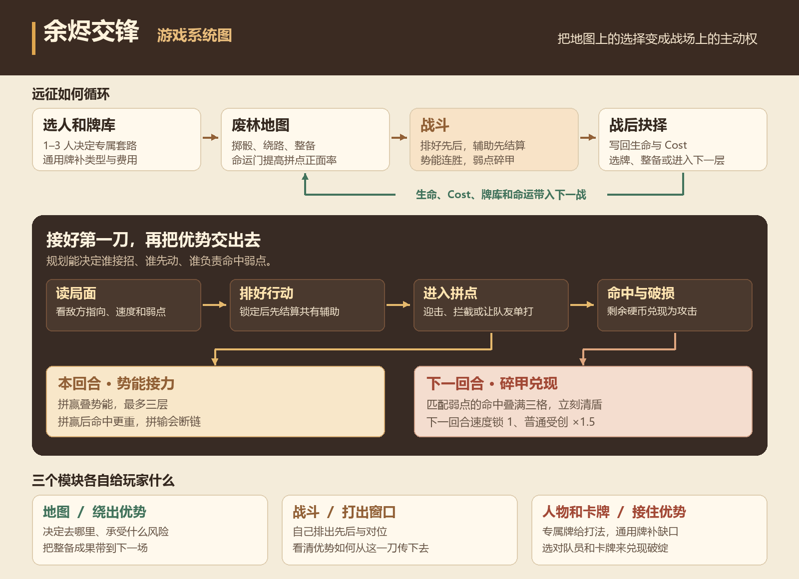
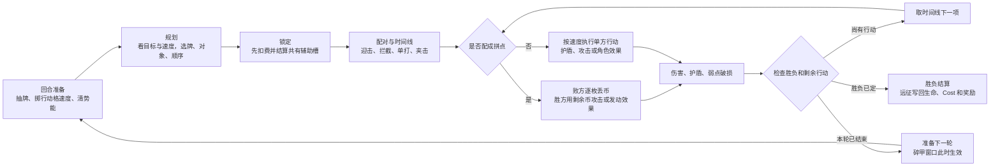

# 余烬交锋｜游戏系统与爽点

基于 2026 年 11 月 23 日的本地工作区。规则以实际入口和结算代码为准。「爽点」是根据规则提出的体验判断，留待试玩验证。

> **我建议把核心爽点定为「我排好了这一回合，下一刀按我的计划打穿」。** 地图让我带着准备进场，辅助和出手顺序让我赢下第一刀，势能把领先传给队友，碎甲让我知道下一轮该把哪一张重牌交给谁。

## 1. 地图｜绕路是为了带着优势开战

| 机制 | 当前逻辑 | 作用与爽点 |
| --- | --- | --- |
| 方格、行动骰、疲劳 | 首层手工布置，第 2–5 层按种子生成，均为 9×7。掷 1d4 得到步数，沿相邻可通行格移动。走路增加疲劳，疲劳 ≥6 时步数 −1，保底 1；结束回合恢复疲劳，整回合没走时恢复更多。 | 给绕路标出成本。剩两步时，玩家决定先踩补给还是走到下一回合更安全的位置。 |
| 迷雾、侦察、巡游 | 已见格继续记在地图上。哨塔扩大视野并给情报，树洞可隐蔽。探索换回合时巡游怪沿路线移动并留下踪迹，碰面且未隐蔽会触发战斗。 | 在未知里逐步看懂地图。看见巡游动向后绕过它，省下的生命和手里的 Cost 都能带进关底。 |
| 遭遇与奖励 | 普通战、精英、巡游和首领进入同一个战斗引擎。胜利后写回生命与 Cost，增加缴获；普通战还有恢复，精英和首领可给遗物，有可选牌时弹出战后三选一。 | 危险格换未来战力。一次原本可绕过的精英，可能补齐一张决定下一战打法的牌。 |
| 休整与整备 | 营地在恢复生命、降疲劳与搜集 Cost 之间选。行商可买卖整备、删牌、复活；神龛能净化或提升最大生命；锻台处理单张卡牌实例；遗迹和庄台给随机抉择。 | 把走地图赚到的资源换成具体准备。删掉一张拖累抽牌的牌，与买一张高爆发牌是两种不同的变强方式。 |
| 命运石之门 | 各门最多领一次，单门给 2 点，余额上限 10。探索事件和战斗也有概率给命运。每档花费依次为 2、3、4、5，全队**拼点**正面率从 45% 升到 60%、75%、90%、100%，点数和档位跨层保留。 | 路线能改变胜算。前期同一张牌要承担风险，做好远征规划后，它可以成为稳定的开场牌。 |
| 关底与五层推进 | 烬心祭坛或归途石门可进关底巨像战。前四层处理奖励后，从增生命与伤害的不同比例中选一项敌方强化，再进下一层。强化累计。第五层首领倒下就结算远征胜利。 | 用刚成形的队伍和更强的关底对账。过层选择让玩家主动决定下一段更难打的地方。 |

完整循环可以用一次路线选择解释。走去命运门花掉行动力，也可能逼近巡游怪。到门后把正面率从 45% 提到 60%，下一场就更容易用低费牌接下第一场拼点。地图的收益最好能在战场上被玩家指出来。

代码入口 [方格生成](../../battle-demo/scripts/forest_random_generator.gd#L34)、[掷骰与节点](../../battle-demo/scripts/forest_run.gd#L306)、[巡游](../../battle-demo/scripts/forest_run.gd#L1130)、[关底结算](../../battle-demo/scripts/forest_run.gd#L1313)。

## 2. 战斗｜本轮连胜与下轮碎甲是两条相连的节奏

### 一轮怎么走

实际时间线会逐个行动检查退场与胜负。拼点与攻击分开掷算，赢得拼点时的数值代表先拿到进攻权，实际掉血仍由剩余硬币、技能、护盾及增益结算。

| 机制 | 当前逻辑 | 玩家能控制什么，爽在哪里 |
| --- | --- | --- |
| 敌情、行动格、预算 | 可见敌方启用格、指向和速度，敌牌锁定后揭晓。每组三个格，最多排两次。进攻牌也可占空闲大招格。规划时预留 Cost，锁定后扣费；本回合首次拼胜 +1 Cost，拼败通常退有效费用的一半向下取整。 | 三个格要取舍，两次机会塞给最值的牌。局面紧时，低费牌挡下一击也有价值。 |
| 迎击、拦截、单打、夹击 | 被点名的队员可直接迎击。替队友接招通常要比敌格更快。一个敌格只配最快的合格我方行动，同速按槽位顺序；其余合围或瞄准空格、防御格的动作单方结算。常规入口启用单打伤害加成，默认 +3。 | 速度决定「谁去扛」。用快手接走危险动作，另一人借机输出，回报来自配对而非单纯堆威力。 |
| 共有辅助槽 | 全队每轮共用一格，防御或辅助牌可放入。牌实例、费用和拥有者照常校验，和个人格不会重复使用同一张牌。它在普通行动前按基础单方效果结算，无实际拼点。 | 提前上盾，或点名下一位接力的人。玩家能先铺路，再看队伍一路兑现。 |
| 硬币拼点 | 基础威力加上正面枚数乘硬币威力，再计入角色、遗物、临时增益等。一次比较输的一方少一枚币，直到一边归零。还剩几枚币，也决定许多攻击还有几段。 | 一枚硬币翻面会改变现在的胜负，也会改变随后有几次命中。用稳牌做第一场与用爆牌搏上限，是实质差别。 |
| 拼刀势能 | 我方每拼赢一次全队 +1 层，最多 3，拼败或换回合归零。每层给之后的拼点基础威力 +1。拼赢之后立即按新层数加伤，通常每段每层 +2 穿盾；少数有 `shielded_momentum` 标记的牌先加进普通伤害，再过护盾。 | **同一回合的接力。** 先用高把握的行动攒一层，再让输出手带着加成赢下一场。拼败中断让顺序有风险。 |
| 斩、刺、重和破损 | 攻击牌的伤害标签与敌人弱点一致，每段命中 +1 破损，护盾挡住伤害时也能叠，最多 3。例子是余烬斩、穿隙、断轨分别对应斩、刺、重。敌方当前已有弱点徽记与三颗进度点。 | **读懂敌人就能主动做进度。** 例如巨像弱重击，普通两段重击能先给它两格破损，为第三段架桥。 |
| 碎甲大失衡 | 敌人破损达到 3，或低于半血且已普通失衡，立即清掉护盾。下一回合普通受创 ×1.5，速度锁 1。之后恢复原速度并清空破损。常规入口可直接用弱点击满触发。 | **跨回合兑现。** 碎甲时有震屏、碎甲字样和音效。真正的战术奖励是下一轮有时间把高费强牌安排进去。 |
| 普通失衡与压制 | 引擎已有开关。普通失衡可由首次跌破半血或同一回合连续两次拼败触发，能中断剩余行动并增加受创。压制在决定胜负的分差 ≥6 时，以额外伤害兑现大胜。当前常规入口未打开这两个开关。 | 这是可选的强化节奏。若未来启用，玩家会同时面对「取消行动」和「为下轮碎甲」两层反馈，需要区分清楚。 |
| 护盾、资源与画面 | 普通伤先过护盾，部分角色护盾可跨回合。一次性增益在接下来的拼点或第一次符合条件的伤害中消费。引擎产生事件，战场按事件显示掷币、打击、护盾、势能与破损。 | 玩家能沿着画面回想「刚才为什么赢」。最有价值的反馈是把施加者、受益人和收益接起来。 |

### 一次能讲给别人听的交锋

1. 看见巨像弱重击。给队伍安排断轨，把 minghe 的清音起手放进共有辅助槽，指定马上要拼点的人。Phase 0 先给该队员下次拼点 +1。
2. 让高把握的行动先拼。赢了，全队势能变为 1，随后行动再用这层威力。断轨如果保有两枚币并都命中，巨像增加两层破损。
3. 下一段重击补到 3 层，当前护盾立即瓦解。到下一回合，巨像速度为 1、普通受创 ×1.5。把可用的爆发牌交给能兑现这一轮的成员。

这套例子要求实际牌库与速度允许对应走法。它提供一个试玩观察重点。玩家能否在碎甲前说出自己在等什么，并在下一轮指出哪张牌吃到了这个机会。

### 已发现的体验读数差异

| 当前工作区 | 对玩家有什么影响 |
| --- | --- |
| 势能 HUD 的 ×1/×2/×3 常量文字与引擎计算不同。HUD 的 ×2 显示「拼点 +1、震击 +3」，×3 显示「拼点 +2、贯穿 +6」。规则在三档分别是后续拼点 +1/+2/+3，通常每段加伤 +2/+4/+6。 | 玩家可能正确连胜却误读自己的收益。优先统一读数，等反馈准确后再谈势能数值是否过强。 |
| 界面已经在敌方画出弱点和破损。破损要求攻击牌 `tag` 完全匹配。当前大量专属牌的标签是角色分类或未设物理类型。 | 实战上经常得靠通用牌铺破损，再交给专属牌兑现窗口。这个分工可以成为构筑选择，前提是出牌前能看懂哪些牌确实叠破损。 |
| 碎甲爆发先清盾，+50% 与锁速等到下一回合；普通失衡属于另一套可选开关。 | 玩家容易在同轮震屏后期待立即增伤。试玩时应看玩家能否分清「盾现在掉」与「下轮才好打」。 |

代码入口 [正常开战配置](../../battle-demo/scripts/planning_ui.gd#L517)、[配对与 Phase 0](../../battle-demo/scripts/battle_rules.gd#L1000)、[拼点](../../battle-demo/scripts/battle_rules.gd#L1260)、[伤害与碎甲](../../battle-demo/scripts/battle_rules.gd#L2036)、[势能 HUD](../../battle-demo/scripts/planning_ui.gd#L753)、[战场反馈](../../battle-demo/scripts/battle_stage.gd#L777)。

## 3. 人物和卡牌｜决定由谁开局，又由谁兑现

出战 1–3 人。远征开局 4 张通用牌，再按每个成员添 2 张专属牌。专属牌由对应角色使用，普通／罕见／稀有同名上限为 3／2／1，牌库上限 22 张。远征每轮默认抽 6，打完一轮弃掉当轮手牌，抽牌堆用尽后洗回。奖励和行商从当前阵容可用牌里选，三选一也能跳过换 2 Cost。部分专属牌用角色资源强化，规划时预留，撤销按对应规则返还。

| 人物 | 机制在干嘛 | 玩这个人的爽点 |
| --- | --- | --- |
| 灰烬 | 从拼赢或打出观察攒准备，捕捉破绽消耗准备抬高拼点，余势追击把胜利转成追加攻击。 | 先读局，再用准备好的牌拿下关键一拼。 |
| 长锋 | 高费牌吃破阵威力，拼输会自扣生命，稳斩和破阵提供高基础值。 | 支付高费用抢强敌的第一刀，为全队打开连胜。 |
| 织火 | 防御牌给自己和队友护盾，援火冲击拼赢也能援护队友。 | 主动进攻也能保护队友，让原本要挨打的人放心排输出。 |
| 十六夜咲夜 | 秒表压低敌速，私人空间抬高自身速度和伤害；咲夜的世界让下回合只有她行动，同场一次。 | 把敌人先动的回合改成自己接管节奏的回合。 |
| 博丽灵梦 | 命中攒退治，印记达到阈值后下轮压敌方。梦想天生蓄能并按各敌印记全体结算，发动后灵梦退场。 | 把前几轮布好的印记集中引爆，承担以自己退场换终结的代价。 |
| ZiXi | 拼点攒超形上学，消耗它强化符卡，继续积累因果律；强化几乎必然能用因果律炸全体。 | 把几次较小的胜利或强化投资攒成预期明确的大招。 |
| ZiXingYC | 拼赢写观测、拼败写反思，符卡整理成推理、生成、检索语料，分别提供回费、增伤、降对手拼点；终招用语料结算全体伤害。 | 失利也能变成后续牌的材料。懂得何时写、何时整理，构筑才会成形。 |
| 雾雨魔理沙 | 专属牌积攒火花，部分攻击打多个目标；极限火花消耗火花放大爆发。符合条件时可拿生命换 Cost。 | 选择继续存，或踩着血线和费用立刻开一轮爆发。 |
| pufufu | 挨打反伤、攒蓬松，给队伍护盾与治疗；厚实壁垒可花蓬松强化，扩展牌提供保护与受击反制。 | 故意把攻击接到可承受的人身上，挨打反而给小队积累资源。 |
| ZiWu | 缺少存活队友能提高拼点和伤害，独行攒绝缘；可选择强化或用高代价的队友互动换个人爆发。 | 少人也有反击路线，做的是「继续多人协作」与「让一人收残局」的舍取。 |
| minghe | 先声夺势给最快队友下次拼点 +1；清音或灵韵定向给下次拼点或伤害，余音绕梁可额外增伤并积律动。和鸣共震做全队铺垫，万象同频消耗律动放大全队的下一次行动。 | 最直接的接力手。让一位队友稳稳开场，另一位带着预置增伤或进碎甲窗口。 |

通用攻击的作用是补物理类型与费用缺口。专属牌的作用是实现角色各自的开局、承压、收益转换或终结。乱收牌会稀释关键牌的抽到率；留牌位给能参与主线的通用牌或低费过桥牌，本身就是构筑回报。

遗物偏持续改规则，道具给单次解题机会，羁绊从配队就开始改变开场或长期收入。锻台的附魔绑定具体卡牌实例。当前能在战斗入口追到**轻灵减费、破势加拼点**，汲血、回响、超频已出现在符文配置里，当前规则未查到对应的战斗消费逻辑，暂时不把三个效果当作已兑现的构筑爽点。

代码入口 [出战角色](../../battle-demo/scripts/battle_rules.gd#L290)、[专属脚本目录](../../battle-demo/scripts/characters)、[组牌与奖励规则](../../battle-demo/scripts/card_pool.gd#L8)、[羁绊](../../battle-demo/scripts/team_synergy.gd#L10)、[符文数据](../../battle-demo/scripts/forest_run.gd#L32)。

## 4. 停下来，先验证这个爽点

给试玩者一场能见到巨像的固定遭遇，保留一张稳拼牌、一张基础重击牌和一张可在下一轮用的爆发牌。第一轮约束是盾还在，第二轮有兑现机会。让玩家自己决定谁先拦截、辅助给谁、何时补第三层破损。

| 模块 | 试玩时听到什么算接上了 |
| --- | --- |
| 地图 | 「我绕到门那里是为了让下一场更好拼，或者先保住进关底的命。」 |
| 战斗 | 「你先接这刀，我用势能补第三格，下一轮把爆发打到碎甲上。」 |
| 人物与卡牌 | 「这张通用重击负责开窗，这个人的专属牌是为了吃窗口。」 |

如果玩家只说「数字变大了」，先核对三处读数。出手前能否识别谁会拼点，命中时能否识别为什么叠破损，换轮后能否识别谁正处于可兑现窗口。三处能连起来，再决定要不要增加新的战斗机制。

本次复核通过了地图、核心战斗、minghe 和战斗反馈的四个无头脚本。文档中的体验判断留给真人试玩。
